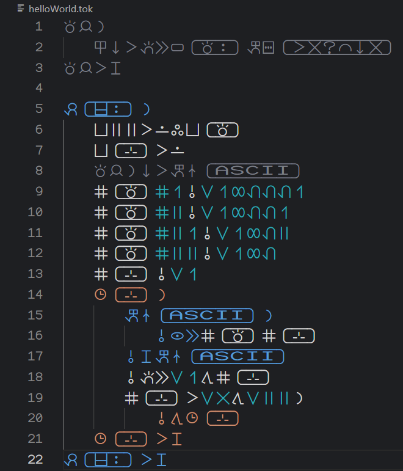

# Toki Ilo
An interpreted sitelen pona programming language.\
In English the name translates literally as "machine language" but means programming language.

## Installation
No current installation instructions

---

Example code:

For documentation click [here](./DOCS.md)